<div align="center">
 https://lechithuan64.github.io/minh-hoa-cay-nhi-phan-tim-kiem/


<a href="https://git.io/typing-svg">
  
</a>

<br/><br/>



<br/><br/>


<br/>


<br/><br/>


</div>


## 🌟 Giới thiệu


**BST Visualizer** là đồ án minh họa **cây nhị phân tìm kiếm (Binary Search Tree)** chạy ngay trên trình duyệt. Bạn nhập số, cây tự động được vẽ lại bằng **SVG**, rồi xem thứ tự thăm các nút theo ba cách duyệt kinh điển.

Viết bằng **HTML, CSS và JavaScript thuần**, chỉ một file duy nhất, không cài đặt, không thư viện. Mở file ra là chạy! 🎉

> 💡 Phù hợp để **học thuật toán**, **làm đồ án môn Cấu trúc dữ liệu và giải thuật**, hoặc **trình bày trực quan** trước lớp.


## ✨ Tính năng nổi bật

- 🌱 **Thêm nút**: nhập một số, hệ thống tự tìm đúng vị trí theo quy tắc BST
- 🗑️ **Xóa nút**: xử lý đầy đủ 3 trường hợp (nút lá, một con, hai con)
- 🎨 **Vẽ cây tự động**: bố cục tự co giãn theo số nút và chiều cao cây
- 🚶 **Ba cách duyệt**: Inorder, Preorder, Postorder, hiển thị kết quả ngay
- 🛡️ **Kiểm tra lỗi**: báo khi chưa nhập số, thêm số trùng, hoặc xóa số không tồn tại
- 🌗 **Giao diện thích ứng**: tự đổi theo chế độ sáng hoặc tối của hệ thống
- 🔄 **Làm lại**: xóa toàn bộ cây chỉ với một cú bấm


## 🚀 Cách chạy

**Cách 1: Mở trực tiếp**

```bash
git clone https://github.com/<ten-tai-khoan>/cay-nhi-phan-tim-kiem.git
cd cay-nhi-phan-tim-kiem
```

Sau đó nhấp đúp vào file `index.html` để mở bằng trình duyệt.

**Cách 2: Dùng máy chủ cục bộ**

```bash
# Python
python -m http.server 8000

# hoặc Node.js
npx serve .
```

Truy cập `http://localhost:8000` để xem kết quả.


## 🎮 Hướng dẫn sử dụng

- **Bước 1:** Nhập một số vào ô *Nhập số*
- **Bước 2:** Bấm **Thêm** để đưa số vào cây, hoặc **Xóa** để loại bỏ số đó
- **Bước 3:** Quan sát cây được vẽ lại ngay lập tức
- **Bước 4:** Bấm một trong ba nút duyệt để xem thứ tự thăm các nút
- **Bước 5:** Bấm **Làm lại** để bắt đầu từ cây rỗng


## 🚶 Ba cách duyệt cây

Với cây ví dụ ở trên:

- 🔵 **Inorder (Trung thứ tự)**: Trái → Gốc → Phải
  `20, 30, 40, 50, 60, 70, 80` ✅ *luôn cho dãy số tăng dần*
- 🟣 **Preorder (Tiền thứ tự)**: Gốc → Trái → Phải
  `50, 30, 20, 40, 70, 60, 80` 📋 *hữu ích khi sao chép cây*
- 🟢 **Postorder (Hậu thứ tự)**: Trái → Phải → Gốc
  `20, 40, 30, 60, 80, 70, 50` 🧹 *hữu ích khi xóa cây*


## 🗑️ Thuật toán xóa nút

Xóa là thao tác phức tạp nhất của BST, chia làm 3 trường hợp:

- 🍃 **Nút lá (không có con):** gỡ trực tiếp khỏi cây
- 🌿 **Nút có một con:** thay nút bị xóa bằng nút con duy nhất của nó
- 🌳 **Nút có hai con:** lấy **nút nhỏ nhất của cây con phải** (nút kế thừa theo thứ tự giữa) thay vào vị trí, rồi xóa nút kế thừa đó


## 📁 Cấu trúc mã nguồn

```
📦 cay-nhi-phan-tim-kiem
 ┣ 📜 index.html          ← Toàn bộ giao diện và logic
 ┣ 🎞️ tree-animated.svg   ← Hình cây động dùng trong README
 ┗ 📜 README.md           ← Tài liệu bạn đang đọc
```

Các hàm chính bên trong `index.html`:

- `mk(v)`: tạo một nút mới
- `ins(n, v)`: thêm giá trị vào cây (đệ quy)
- `del(n, v)`: xóa giá trị khỏi cây, xử lý đủ 3 trường hợp
- `minNode(n)`: tìm nút nhỏ nhất của một cây con
- `has(n, v)`: kiểm tra giá trị có tồn tại trong cây hay không
- `countNodes(n)` và `depth(n)`: đếm số nút và tính chiều cao cây
- `draw()`: tính tọa độ từng nút rồi vẽ cây bằng SVG
- `walk(x, mode, res)`: duyệt cây theo `in`, `pre` hoặc `post`
- `show(mode)`: hiển thị kết quả duyệt ra màn hình


## ⏱️ Độ phức tạp

- ⚡ **Trường hợp trung bình** (cây cân đối): thêm, xóa, tìm kiếm đều **O(log n)**
- 🐌 **Trường hợp xấu nhất** (cây lệch thành một đường thẳng, ví dụ thêm `1, 2, 3, 4, 5`): **O(n)**
- 🚶 **Duyệt cây**: luôn **O(n)** vì phải thăm mọi nút
- 💾 **Bộ nhớ**: **O(n)** cho n nút


## 🛠️ Công nghệ sử dụng

- **HTML5**: khung giao diện và các phần tử nhập liệu
- **CSS3**: biến màu, tự thích ứng chế độ sáng và tối
- **JavaScript (ES6)**: toàn bộ thuật toán và xử lý sự kiện
- **SVG**: vẽ nút, cạnh và bố cục cây


## 🔮 Hướng phát triển

- [ ] Thêm chức năng **tìm kiếm** có tô sáng đường đi
- [ ] Hiệu ứng **từng bước** khi thêm, xóa và duyệt cây
- [ ] Mở rộng sang **cây AVL** tự cân bằng
- [ ] Thêm nút **tạo cây ngẫu nhiên**
- [ ] Lưu và nạp cây từ file


## 👨‍💻 Tác giả

<div align="center">


⭐ *Nếu thấy dự án hữu ích, hãy cho mình một ngôi sao nhé!* ⭐

<br/>


</div>
